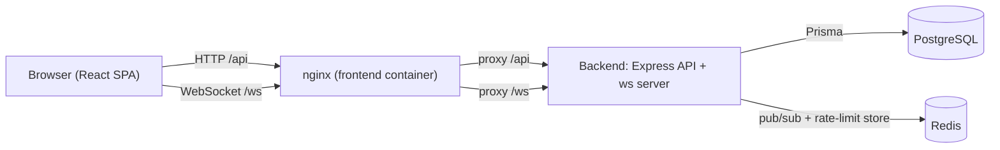
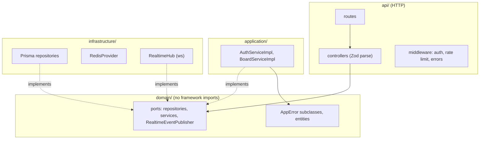
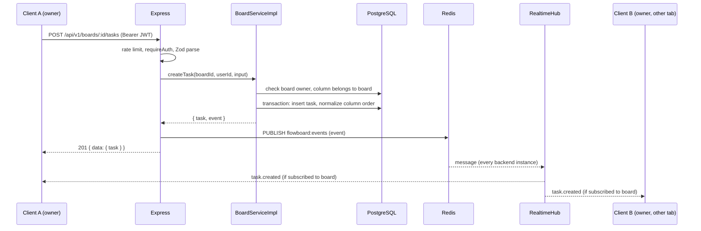
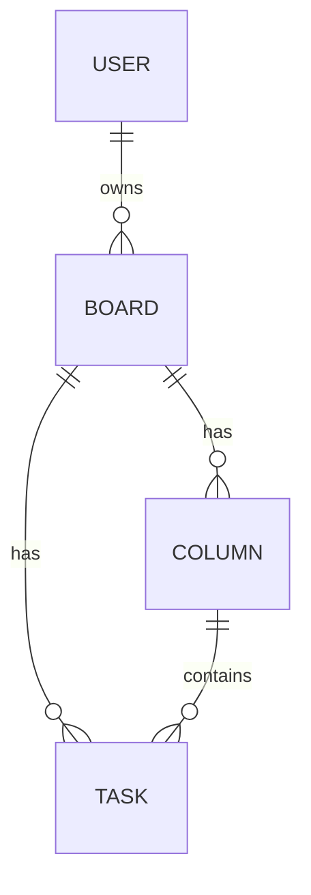

# FlowBoard architecture

This document describes how FlowBoard is built and why. Everything here was
checked against the code; where behaviour is a limitation it says so.

## 1. System overview

- **Frontend** (`frontend/`): React 19 SPA. REST client in `src/api/client.ts`,
  WebSocket client in `src/api/socket.ts`, board page in `src/pages/Board.tsx`.
- **nginx** serves the built SPA and proxies `/api` and `/ws` to the backend,
  so the browser talks to a single origin.
- **Backend** (`backend/`): one Node process hosts the REST API and the
  WebSocket server on the same HTTP server (`server.ts`).
- **PostgreSQL** stores users, boards, columns and tasks (`prisma/schema.prisma`).
- **Redis** has two jobs: pub/sub channel for realtime events, and shared
  store for the rate limiters.

## 2. Backend layers

| Layer | Path | Responsibility |
|-------|------|----------------|
| domain | `src/domain` | Entities, interfaces (ports) for repositories, services and the realtime publisher, and the `AppError` hierarchy. |
| application | `src/application/services` | Business rules: ownership checks, title validation, column/task rules, ordering, building realtime events. |
| infrastructure | `src/infrastructure` | Prisma repositories, Redis connections, the WebSocket hub. |
| api | `src/api` | Routes, controllers, auth/rate-limit/error middleware. |
| composition root | `src/server.ts` (tests: `tests/helpers.ts`) | Constructs everything and passes dependencies in by constructor. No DI framework. |

Controllers depend on the `BoardService` and `RealtimeEventPublisher`
interfaces, not on Prisma or Redis.

## 3. Request flow: creating a card

Note the order: the database transaction commits first, then the event is
published. Publishing is fire-and-forget (errors are only logged), so a Redis
failure after the commit loses that event; clients recover by refetching.

## 4. Realtime protocol

1. Client opens `ws(s)://host/ws` with subprotocols `["flowboard", <jwt>]`.
   `handleProtocols` in `server.ts` picks the `flowboard` protocol and stashes
   the token on the request.
2. `RealtimeHub.handleConnection` checks, in order: capacity (500 sockets),
   `Origin` against `CORS_ORIGIN`, token presence, token validity, per-user
   cap (8 sockets). Rejections use close codes `1013`, `1008`, `4401`, `4408`.
3. Server sends `{ type: "connected" }`.
4. Client sends `{ type: "subscribe", boardId }`. The hub calls
   `BoardService.getBoard(boardId, userId)`, which enforces ownership, and
   only then registers the subscription and replies `subscribed`.
5. Events (`task.created`, `task.updated`, `task.deleted`, `column.added`)
   reach only sockets subscribed to that event's board.
6. Heartbeat: ping every 30 s; a socket that missed the previous ping is
   terminated. `maxPayload` is 16 KB.

Event delivery is at-most-once with no ordering guarantee beyond Redis
channel order and no replay. The frontend refetches the board after a
reconnect and after a failed action.

## 5. Data model

IDs are UUIDs. Deleting a user, board or column cascades to its children.
`tasks.order` and `columns.order` define display order; indexes are on
`(board_id, order)`.

## 6. Design decisions

### 6.1 Layered architecture with ports
**Decision:** services depend on repository interfaces; Prisma classes implement them.
**Why:** business rules (ownership, ordering) can be read without Prisma, and a
fake repository could replace the database in unit tests.
**Honest note:** the current tests do not use fakes; they run against a real
database, so this flexibility is available but not exploited.

### 6.2 Redis pub/sub for realtime fan-out
**Decision:** mutations publish to `flowboard:events`; every instance relays to
its own local sockets.
**Why:** with a plain in-process broadcast, a user connected to instance A would
miss events produced on instance B. Pub/sub keeps instances stateless.
**Trade-off:** at-most-once delivery, no replay, an extra dependency. Redis
needs two connections because a connection in subscribe mode cannot run other
commands (`RedisProvider.client` and `.subscriber`).

### 6.3 Authorization at subscribe time
**Decision:** ownership is verified when a socket subscribes, not when each
event is sent.
**Why:** cheap fan-out. **Trade-off:** if board access were ever revoked, an
existing subscription would keep receiving events. Not reachable today because
boards are single-owner and cannot be shared or transferred.

### 6.4 Zod validation at the edge
**Decision:** each controller parses `req.body`/`req.params` with a Zod schema;
a thrown `ZodError` is turned into a `400 VALIDATION_ERROR` by the central
error handler. Services re-check key rules (titles, lengths) themselves.
**Why:** invalid input never reaches business logic; one error shape for clients.
**Honest note:** `validateBody`/`validateParams` middleware exists in
`api/middleware/errors.ts` but is not used; it is dead code to remove.

### 6.5 One error envelope, typed errors
**Decision:** expected failures extend `AppError(status, code, message)`;
`errorHandler` maps them to `{ error: { code, message } }`. Anything else is a
generic `500 INTERNAL_ERROR` and the real error is only logged.
**Why:** clients rely on one shape; internal details do not leak.

### 6.6 Task ordering inside a transaction
**Decision:** create/move/delete run in `runInTransaction`, which creates a
repository bound to the Prisma transaction; the affected columns are then
re-indexed to `0..n-1`.
**Why:** a half-applied move cannot leave the board inconsistent.
**Limitations:** there is no row locking. Two concurrent creates can read the
same `maxTaskOrder` and temporarily share an order; the next normalization
tie-breaks on `createdAt`. Re-indexing runs one UPDATE per task, which is
fine for small boards and would need a set-based query for large ones.

### 6.7 JWT with pinned claims; secrets from the environment
**Decision:** tokens are HS256 with issuer `flowboard` and audience
`flowboard-web`, verified with an explicit algorithm list. In production the
server refuses to start if `JWT_SECRET` is shorter than 32 characters or a
known placeholder (`config/env.ts`). Passwords are hashed with bcrypt (10 rounds).
**Trade-offs:** the frontend stores the token in `localStorage` (readable by
XSS), and there is no refresh or revocation.

### 6.8 Rate limits in Redis
**Decision:** `express-rate-limit` with a Redis store: register 10/hour,
login 20/15 min, other API routes 120/min, keyed by client IP.
**Why:** counts are shared across instances and survive restarts. nginx sets
the forwarded IP and the app uses `trust proxy = 1`.
**Gap:** limiters are disabled when `NODE_ENV=test`, so they have no tests yet.

## 7. Deployment

- **Docker Compose:** postgres, redis, backend, frontend (nginx). The backend
  container runs `prisma migrate deploy` and then starts the server.
- **Kubernetes:** Kustomize manifests in `infra/k8s/`, not verified against a
  live cluster in this repository.
- **CI:** `.github/workflows/ci.yml`: production-dependency audit, typecheck, ESLint, Prettier
  check, tests (backend with a coverage floor), build, and Docker image builds.
- **Shutdown:** on SIGTERM/SIGINT the server terminates sockets, closes the
  HTTP server, disconnects Redis and Prisma, with a 10 s forced-exit timer.

## 8. Known weak spots

- WebSocket hub and rate limiters: little or no automated test coverage.
- Migrations run at container start; several replicas starting together can race.
- `requireColumn` loads the whole board to check one column.
- Origin check reads a custom `allowOrigins` property that `server.ts` adds to
  the `ws` options object; a `verifyClient` check would be more standard.
